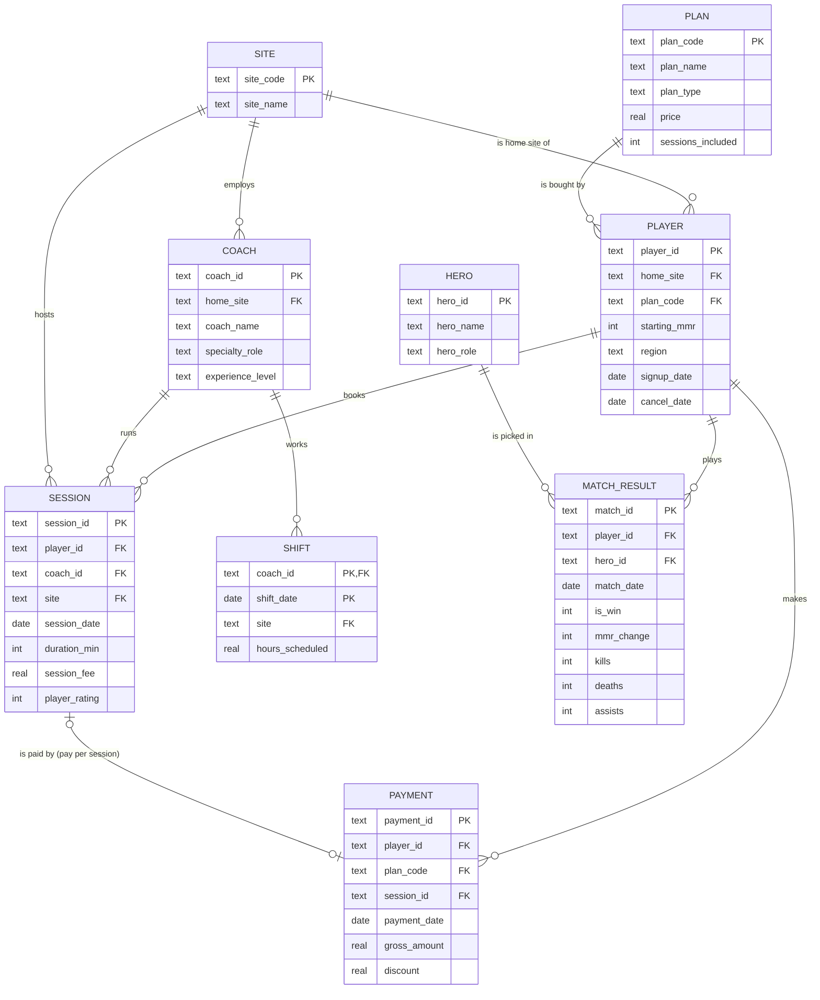
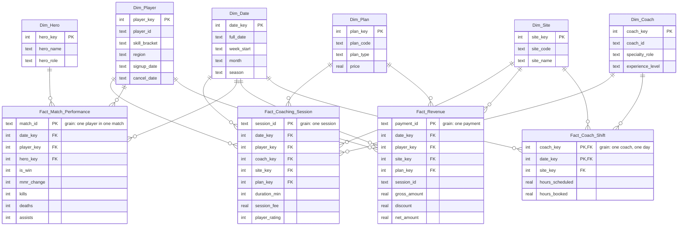

# AegisIQ Reporting Data Warehouse

I designed and built an end-to-end reporting warehouse for a fictional company that coaches people to get better at an online video game (Dota 2). I took it from requirements to an ER diagram, a star schema, a data mapping, a Python ETL, four SQL business queries and a dashboard.

> **All data in this project is synthetic.** AegisIQ was a graduate course case (M.S. Business Analytics, Lewis University). I designed the ER diagram and star schema in the course, then rebuilt the whole thing as a working project. I generated the source data with `etl/generate_sample_data.py` (fixed random seed). No real company, player or payment is involved, and my findings below describe that generated data, not the real world.

## Plain-English terms

| Term | What it means here |
|---|---|
| **Dota 2** | A popular online team video game. Two teams of five play a match that lasts about 40 minutes. |
| **Hero** | The character a player chooses to play in a match (like choosing a position in a sport). |
| **MMR (skill rating)** | Short for *matchmaking rating*: the game's score of how good a player is. Win a match and it goes up (about 25 points); lose and it goes down. A rising MMR means the player is improving. |
| **Coaching session** | A paid 60- or 90-minute lesson with one of the company's coaches. |
| **Coach utilization** | Hours coaches actually spent teaching, as a % of the hours they were scheduled to work. |
| **Data warehouse** | One central database built for reporting, so every site's numbers are counted the same way. |

## The business problem

AegisIQ sells Dota 2 coaching from **four sites** (Austin, Chicago, Seattle, Atlanta) with about 150 staff. Each site kept its own spreadsheets and exports, typed site names its own way, and counted things differently, so leadership could not compare sites or trust the totals.

I built **one shared reporting database** so every site reports four areas the same way.

1. **Player performance**: how players' match results and skill rating (MMR) change over time
2. **Coaching sessions**: who coached whom, when, and for how long
3. **Revenue**: what each plan and session earns, by site
4. **Staffing**: how busy coaches are compared with the hours they are scheduled

## What I did, step by step

| # | Step | What I produced |
|---|---|---|
| 1 | **Requirements**: I listed the questions leaders needed answered | the 4 questions in [Findings](#findings) |
| 2 | **ER diagram**: I mapped the business entities, primary keys, foreign keys and relationships | [docs/er_diagram.png](docs/er_diagram.png) (source: `docs/er_diagram.mmd`) |
| 3 | **Star schema**: I reshaped it for reporting into 4 fact tables (events) and 6 dimension tables (descriptions) | [docs/star_schema.png](docs/star_schema.png), [sql/01_create_tables.sql](sql/01_create_tables.sql) |
| 4 | **Data mapping**: I documented which source field feeds each warehouse column | [docs/data_mapping.md](docs/data_mapping.md) |
| 5 | **ETL**: I wrote a Python pipeline that cleans the site exports and loads the warehouse | [etl/load_warehouse.py](etl/load_warehouse.py) |
| 6 | **Queries**: I answered the 4 questions in SQL | [sql/02_business_queries.sql](sql/02_business_queries.sql), [results/](results/) |
| 7 | **Dashboard**: I built a dashboard to show the answers | [dashboard/index.html](dashboard/index.html) |

### ER diagram (source systems)



### Star schema (warehouse)



| Fact table | Grain (one row =) | Measures |
|---|---|---|
| Fact_Coaching_Session | one coaching session | duration, session fee, player rating |
| Fact_Match_Performance | one player in one match | win/loss, MMR change, kills, deaths, assists |
| Fact_Revenue | one payment | gross amount, discount, net amount |
| Fact_Coach_Shift | one coach on one day | hours scheduled, hours booked |

Shared dimensions: **Dim_Date, Dim_Player, Dim_Coach, Dim_Site, Dim_Hero, Dim_Plan.**

## How to run it

Needs Python 3 and pandas (`pip install pandas`). From the repo folder:

```bash
python3 etl/generate_sample_data.py && python3 etl/load_warehouse.py && python3 run_queries.py
```

1. `generate_sample_data.py` writes the synthetic CSV exports to `data/raw/` (shared lists plus one folder per site).
2. `load_warehouse.py` cleans them, builds `aegisiq.db` (SQLite), and prints row counts and the data-quality check.
3. `run_queries.py` runs the 4 queries, saves each answer to `results/*.csv` and refreshes the data inside `dashboard/index.html`.

Then open `dashboard/index.html` in a browser. To explore the warehouse yourself, open `aegisiq.db` in any SQLite tool (for example DB Browser for SQLite).

## What I cleaned

I made the generated exports messy the way real site exports are, then wrote the ETL to fix them. In the final run it:

- **Standardized 767 site names** typed inconsistently (`austin`, `AUS`, `Seattle WA`, `Chicago ` with a trailing space …) to one official code per site. I made an unknown spelling stop the load instead of being guessed.
- **Removed 142 duplicate session rows** (the same `session_id` exported twice).
- **Kept 441 blank session ratings as NULL** rather than inventing a score.
- **Calculated hours booked** per coach per day from the cleaned sessions, so staffing and session numbers always agree.
- **Checked every foreign key**: 0 violations.

Rows loaded: 4 sites, 175 days, 1,140 players, 38 coaches, 20 heroes, 3 plans, 14,334 coaching sessions, 45,809 match rows, 5,108 payments, 4,557 coach shifts.

**Data-quality check (weekly sessions vs payments):** every pay-per-session session should have exactly one payment, so I built a check that compares the two counts week by week. It found **41 of 2,897 pay-per-session sessions (1.4%) with no payment, spread over 19 of 25 weeks**, which I flagged for finance before trusting the revenue numbers. The full weekly table is in `results/dq_weekly_sessions_vs_payments.csv`.

## Findings

Period: 6 Jan – 29 Jun 2025 (25 weeks). **Synthetic data**: these are the results my queries returned on the generated data, not real business results.

**1. Do players who get more coaching improve their skill rating (MMR) faster?** I found yes: players who booked more lessons gained more rating points per month and won more often.

| Sessions per month | Players | Avg skill-rating (MMR) change / month | Win rate |
|---|---|---|---|
| under 2 | 449 | −8.7 | 48.2% |
| 2–4 | 351 | −1.7 | 49.9% |
| 4–6 | 180 | +10.9 | 52.0% |
| 6+ | 160 | +25.6 | 54.4% |

Caveat: I built a small coaching effect into the data generator, so this pattern was expected. It is a link, not proof that coaching causes the gain.

**2. Which site earns the most per coaching hour?** I found Austin earned the most per hour actually coached (**$32.89**). Seattle earned the most per hour scheduled (**$25.59**) because its coaches were almost never idle, and Atlanta earned the least on both (**$28.82** booked, **$12.84** scheduled).

| Site | Net revenue | Booked hours | Scheduled hours | $ / booked hour | $ / scheduled hour |
|---|---|---|---|---|---|
| Austin | $131,578 | 4,001 | 7,212 | 32.89 | 18.24 |
| Chicago | $110,210 | 3,566 | 7,254 | 30.91 | 15.19 |
| Seattle | $146,470 | 5,026 | 5,724 | 29.14 | 25.59 |
| Atlanta | $91,848 | 3,187 | 7,152 | 28.82 | 12.84 |

**3. Are coaches overbooked or idle?** I found Seattle overbooked: its 8 coaches were booked above 100% of scheduled hours in **13 of 25 weeks**, peaking at **132.9%** (week of 28 Apr). From April on, Atlanta averaged **61.6%** and Chicago **65.4%**. Over the whole period utilization was Seattle 87.8%, Austin 55.5%, Chicago 49.2%, Atlanta 44.6% (early weeks are low because players were still signing up). My recommendation: move coaching hours from Atlanta and Chicago to Seattle, or hire for Seattle.

**4. Which plans bring the most revenue and the longest-staying players?** I found Monthly Pro had the fewest players but the most revenue and the best retention.

| Plan | Paying players | Net revenue | Revenue / player | Avg months retained | Still active |
|---|---|---|---|---|---|
| Monthly Pro | 222 | $187,770 | $846 | 3.5 | 76.6% |
| Monthly Basic | 390 | $166,416 | $427 | 3.2 | 66.7% |
| Pay Per Session | 496 | $125,920 | $254 | 2.9 | 48.2% |

Total net revenue was $480,106, and I checked that Q2 and Q4 both add up to it. Retention is measured up to 29 Jun 2025, so plans with more active players are undercounted slightly.

## Dashboard

I built `dashboard/index.html` as a single static page (Chart.js, no paid tools) with one chart per question. `run_queries.py` writes the latest query results into it, so it always matches `results/`.

## Repo layout

```
etl/generate_sample_data.py   synthetic source CSVs (fixed seed 42)
etl/load_warehouse.py         clean + build dimensions + load facts + quality check
sql/01_create_tables.sql      star schema DDL (primary and foreign keys)
sql/02_business_queries.sql   the 4 business queries
run_queries.py                run the queries -> results/*.csv + dashboard data
dashboard/index.html          the dashboard
docs/                         ER diagram, star schema, data mapping, interview walkthrough
data/raw/                     generated source data (synthetic)
results/                      query outputs
```

Tools: Python (pandas), SQLite, SQL, Chart.js, Mermaid.
